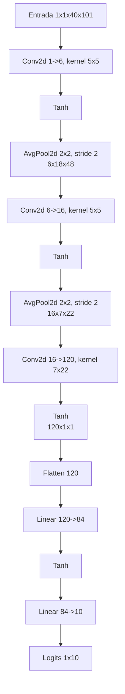
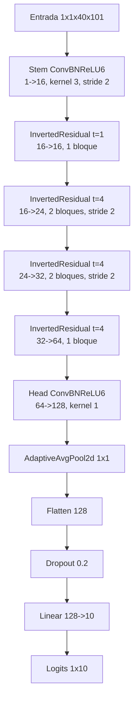

# Diagramas de arquitecturas - Fase 2

## Modelo A - LeNet-5 adaptado

Resumen:

- Parametros: `309,386`.
- MACs aproximadas: `2,308,800`.
- Estandarizacion: `(x - (-6.5107)) / 4.8010` dentro del modelo.

## Modelo B - MobileNetV2 reducido

Resumen:
- Parametros: `50,410`.
- MACs aproximadas: `6,440,800`.
- Estandarizacion: `(x - (-6.5107)) / 4.8010` dentro del modelo.

## Validacion ONNX

- Modelo A: entrada `[1, 1, 40, 101]`, salida `[1, 10]`, diferencia maxima `1.15e-7`.
- Modelo B: entrada `[1, 1, 40, 101]`, salida `[1, 10]`, diferencia maxima `1.09e-11`.
- Opset: `17`; ejecucion validada con ONNX Runtime en CPU.
